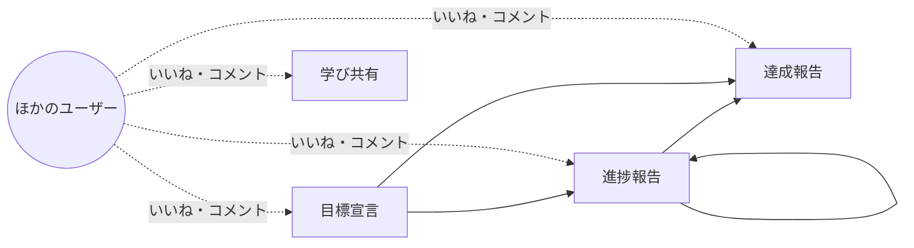
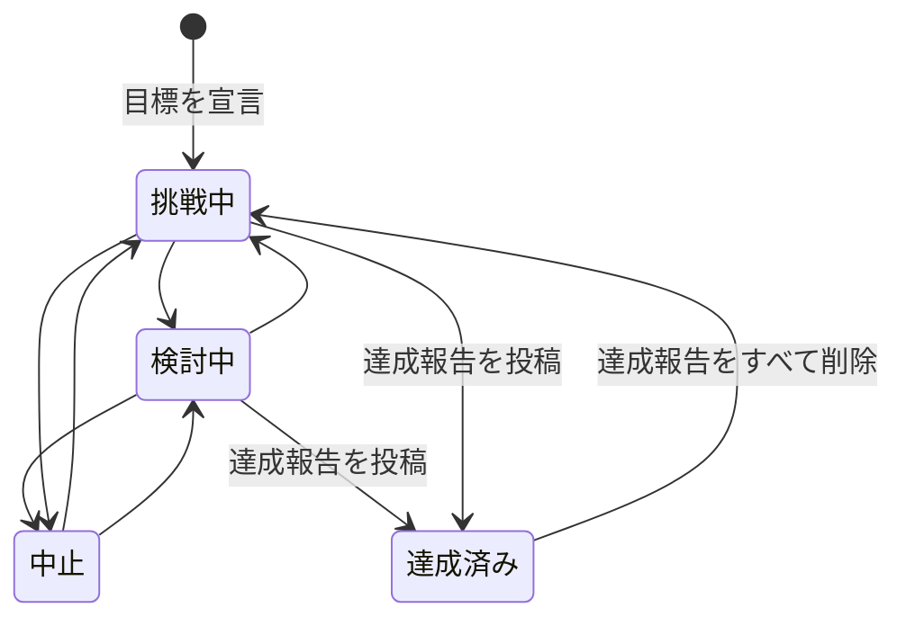
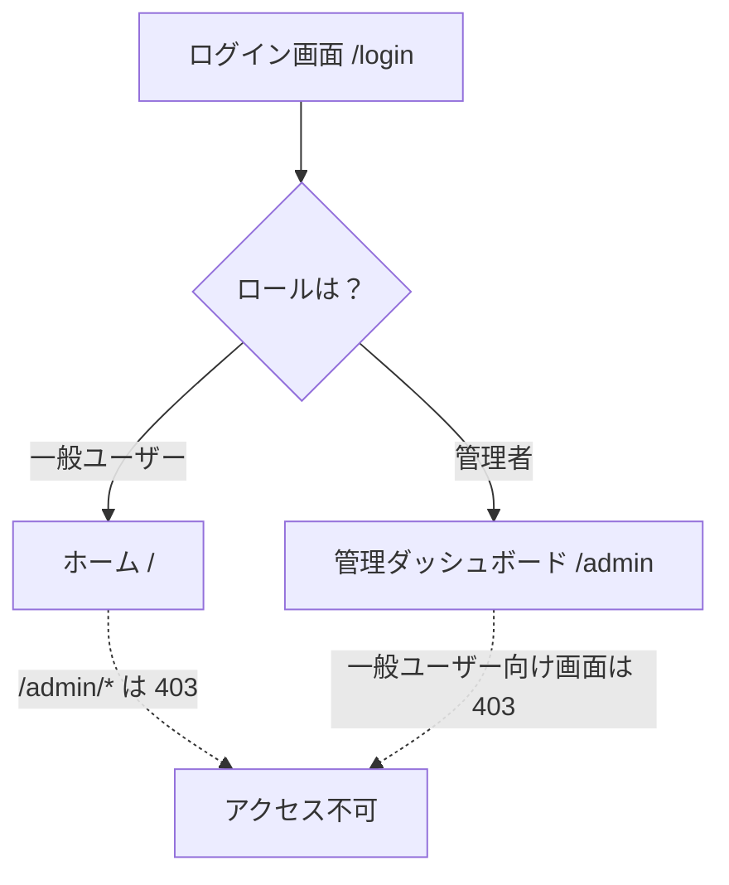
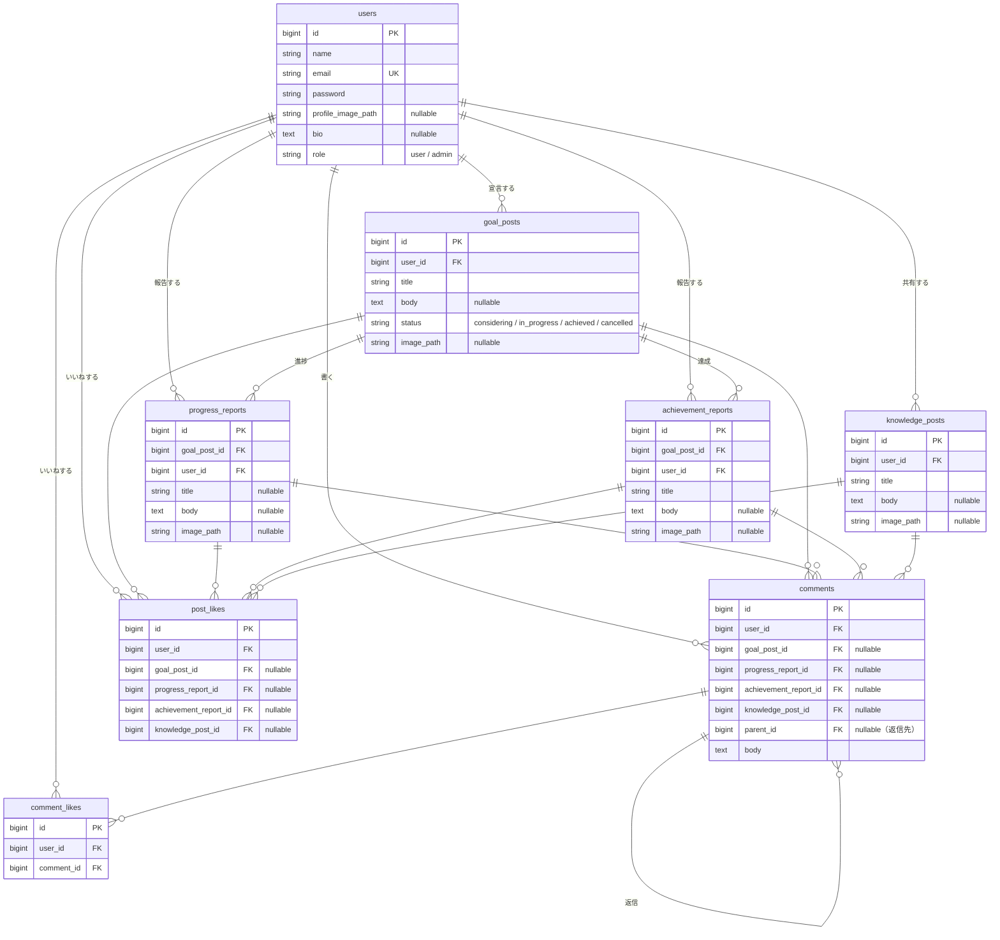
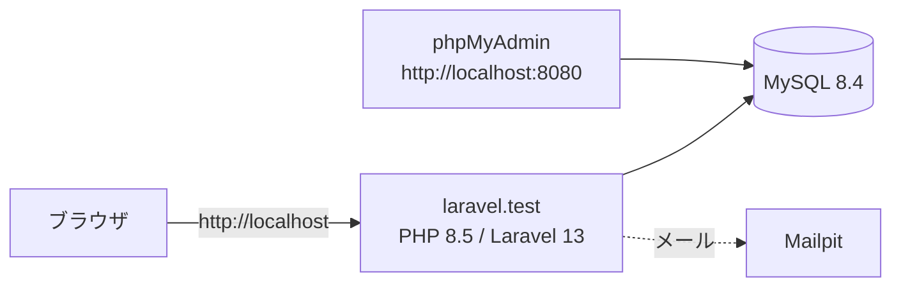

# YourGoal

目標を宣言し、その進捗や達成をみんなに報告しながら、学びを共有し合うSNSです。

## アプリの概要

YourGoal では、4種類の投稿ができます。

| 投稿の種類 | 内容 |
|---|---|
| 目標宣言 | 「英検2級に合格する」など、これから挑戦する目標を宣言する |
| 進捗報告 | 宣言した目標に向けて、今日やったことや気づきを記録する |
| 達成報告 | 目標を達成したことを報告する（報告すると目標が「達成済み」になる） |
| 学び共有 | 目標とは関係なく、学んだことや役に立つ知識を共有する |

進捗報告と達成報告は、自分が宣言した目標にひもづけて投稿します。ほかのユーザーの投稿には、いいねやコメントで応援できます。



## 主な機能

### 一般ユーザー向け

- **ユーザー登録・ログイン・ログアウト**
- **ホーム（フィード）**：4種類の投稿をまとめて表示する。「おすすめ順（いいねの多い順）」と「新着順」を切り替えられる
- **投稿**：目標宣言・進捗報告・達成報告・学び共有の作成、編集、削除（画像を1枚添付できる）
- **目標のステータス変更**：検討中・挑戦中・達成済み・中止
- **いいね**：投稿とコメントにいいねする、取り消す
- **コメント**：投稿へのコメントと、コメントへの返信（入れ子で表示）。自分のコメントは編集・削除できる
- **検索**：キーワード（タイトル・本文・投稿者名）と投稿の種類で検索する
- **プロフィール**：自己紹介・プロフィール画像の編集。目標の一覧、達成履歴、最近の投稿を表示する

目標のステータスは、次のように変わります。



### 管理者向け

- **ダッシュボード**：一般ユーザー数、投稿数（種類ごと）、今日のコメント数
- **ユーザー管理**：一覧・検索（名前・メールアドレス）、詳細（そのユーザーの投稿）、削除
- **投稿管理**：一覧・検索（キーワード・投稿の種類）、詳細、不適切な投稿の削除
- **コメント管理**：一覧・検索（キーワード・投稿の種類）、詳細（返信の一覧）、不適切なコメントの削除

### ログインとロール

ログイン画面は一般ユーザーと管理者で共通です。ログイン後、ロールに応じて行き先が変わります。一般ユーザーは管理画面に、管理者は一般ユーザー向けの画面に入れません。



## データベース構成

コメントといいねは、4種類の投稿のどれか1つにひもづきます（4つの外部キーのうち1つだけに値が入ります）。ユーザーや投稿を削除すると、ひもづくコメント・いいね・報告も一緒に削除されます。



いいねは、同じユーザーが同じ投稿・コメントに2回以上できないよう、ユニーク制約をかけています。

## 使っている技術

| 分類 | 技術 |
|---|---|
| 言語 | PHP 8.5（Sail のコンテナ）／ composer.json の要件は PHP 8.3 以上 |
| フレームワーク | Laravel 13 |
| 認証 | Laravel Fortify（登録・ログイン・ログアウト） |
| データベース | MySQL 8.4 |
| 開発環境 | Laravel Sail（Docker） |
| 開発用ツール | phpMyAdmin、Mailpit |
| テスト | PHPUnit |
| コード整形 | Laravel Pint |



## 環境構築の手順

Docker Desktop が起動している状態で、次の手順を順番に実行します。

### 1. リポジトリを取得する

```sh
git clone https://github.com/ryoga613/YourGoal.git
cd YourGoal
```

### 2. 依存パッケージをインストールする

PHP や Composer を手元に入れなくても、Docker でインストールできます。

```sh
docker run --rm \
    -u "$(id -u):$(id -g)" \
    -v "$(pwd):/var/www/html" \
    -w /var/www/html \
    laravelsail/php84-composer:latest \
    composer install --ignore-platform-reqs
```

### 3. `.env` を用意する

```sh
cp .env.example .env
```

`.env` のデータベースの設定を、Sail の MySQL に合わせて書き換えます。

```dotenv
APP_URL=http://localhost

DB_CONNECTION=mysql
DB_HOST=mysql
DB_PORT=3306
DB_DATABASE=laravel
DB_USERNAME=sail
DB_PASSWORD=password
```

### 4. Sail を起動する

```sh
./vendor/bin/sail up -d
```

### 5. アプリの準備をする

```sh
# 暗号化キーを作る
./vendor/bin/sail artisan key:generate

# テーブルを作り、テストデータを入れる
./vendor/bin/sail artisan migrate:fresh --seed

# アップロードした画像を表示できるようにする
./vendor/bin/sail artisan storage:link
```

シーダーは、ユーザー約1,000人・投稿約1.3万件・コメント約2万件のテストデータを作ります。終わるまで数分かかります。

### 6. ブラウザで開く

| 画面 | URL |
|---|---|
| アプリ | http://localhost |
| phpMyAdmin | http://localhost:8080 |

止めるときは `./vendor/bin/sail down` を実行します。

## テストの実行方法

```sh
# すべてのテストを実行する
./vendor/bin/sail artisan test

# 1つのファイルだけ実行する
./vendor/bin/sail artisan test tests/Feature/FeedTest.php

# コードの書き方をチェックする
./vendor/bin/sail pint --test
```

テストは実行のたびにデータベースを作り直します（`RefreshDatabase`）。

## テスト用のログインアカウント

`migrate --seed` を実行すると、次のアカウントが作られます。

| ロール | メールアドレス | パスワード |
|---|---|---|
| 一般ユーザー | test@example.com | password |
| 管理者 | admin@example.com | password |
